## 

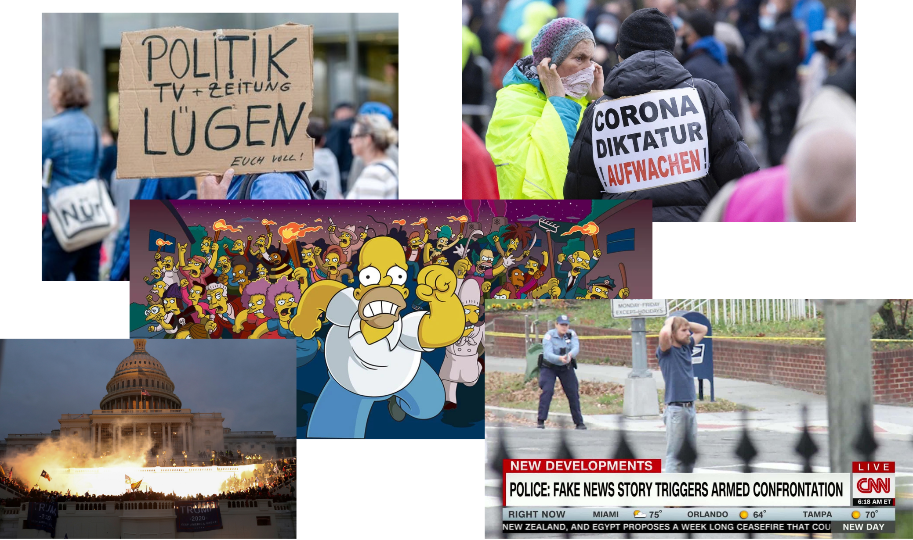


::: notes

- the phenomena of fake news, misinformation and conspiracy theories have received growing concern in recent years

- what has received surprisingly little attention in this context -- and you can spot traces of it here in many of the pictures related to misinformation -- are emotions

[CLICK]

::: 


# What is the role of emotions in misinformation spread on social media?

::: notes

- so today, i'm talking about the role of emotions in how misinformation spreads, focusing on social media

:::

## What is misinformation really?

<br>

::: columns


::: {.column width="50%"}

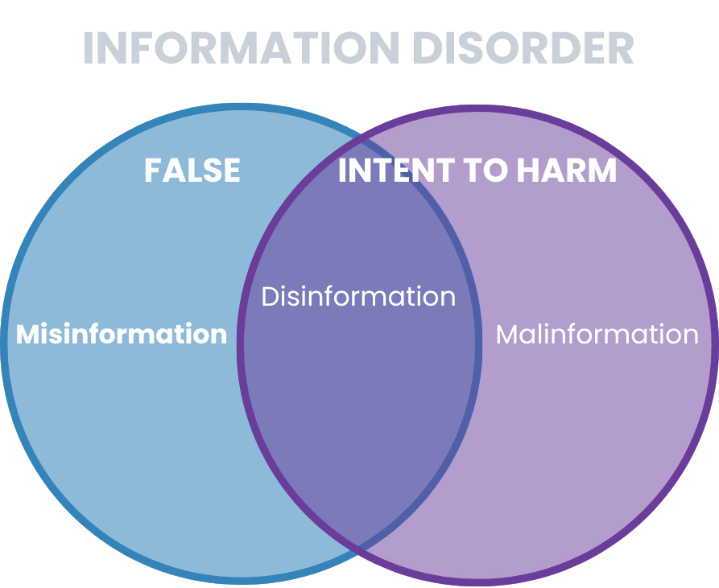{width="100%"}


:::


::: {.column width="50%"}


<br>

::: {style="position: relative; min-height: 120px;"}

::: {.fragment .fade-in-then-out style="position: absolute; top: 0; left: 0; width: 100%;"}

> Disinformation = "Information that is **false** and deliberately created to **harm** a person, social group, organization or country."

:::

::: {.fragment .fade-in-then-out style="position: absolute; top: 0; left: 0; width: 100%;"}

> ~~Disinformation = "Information that is **false** and deliberately created to **harm** a person, social group, organization or country."~~

<br>

$\rightarrow$ in reality, it is hard to determine the exact intention

:::

::: {.fragment style="position: absolute; top: 0; left: 0; width: 100%;"}

> Misinformation = "Information that is **false**, but not created with the intention of causing **harm**."


$\rightarrow$ misinformation is used as an **umbrella term for inaccurate information**
:::


:::


:::

:::


::: notes

- but what is misinformation really? 

- researchers have come up with two dimensions distinguishing different types information disorders: facticity and intent to harm

- disinformation and malinformation (like hate speech), here on the right-hand side, are deliberately spread to harm a person, social group, organization, or country, but only disinformation contains false information

- however, in practice, it is very hard to determine the intention of content distributed on social media

- so, in research that is less focused on coordinated disinformation campaigns, misinformation, here on the left side in blue, is used as an umbrella term and broadly captures all types of inaccurate information, regardless of the intention

:::

## The prevalence of misinformation on social media


::: columns

- Misinformation makes up only a **small fraction** of shared and consumed news on social media<sup>1</sup>

::: {.column width="40%"}

::: {.fragment data-fragment-index="1"}

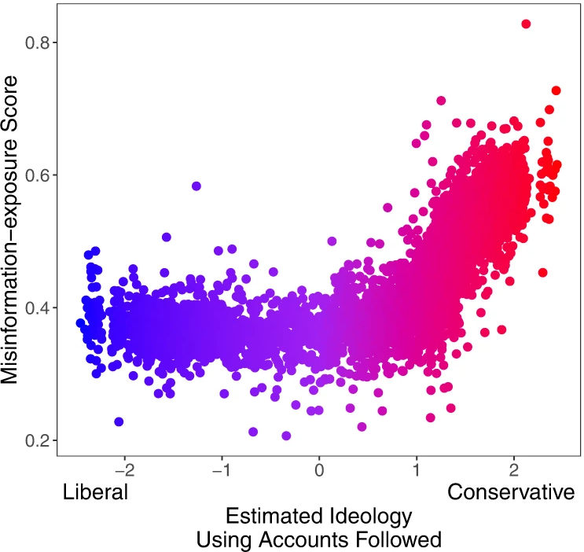{width="90%" fig-align="left"}
:::


:::

::: {.column width="60%"}

::: {.fragment data-fragment-index="1"}
 

- the production and consumption is **heavily concentrated** in partisan and extreme communities [@grinbergFakeNewsTwitter2019; @baribi-bartovSupersharersFakeNews2024]

:::

::: {.fragment data-fragment-index="2"}

- symptom of **dysfunctional information ecosystems** [@jungherrDisinformationStructuralTransformations2021]


:::


::: {.fragment data-fragment-index="3"}

- where it overlaps with negative emotions [@prollochsEmotionsOnlineRumor2021; @zolloEmotionalDynamicsAge2015], harmful language [@moslehMisinformationHarmfulLanguage2024] and moral outrage [@mcloughlinMisinformationExploitsOutrage2024]

:::

:::

:::

::: footer
<sup>1</sup>depending on measurement and topic [@scharfbilligFracturedReality2026]

:::


::: notes

- when measuring the prevalence of misinformation, research shows that it makes up only a small fraction of shared and consumed news online, ranging from 0.15% to 20% heavily depending on the measurement method and where to draw the line on truth

- the production and consumption is heavily concentrated

- when we look at the users who are exposed to it, we typically see this banana shape, with right-wing and conservative users being exposed to or actively sharing misinformation -- here shown in red with their ideology on the x-axis and exposure on the y-axis

- therefore, misinformation is understood as a symptom, not cause, of deeper dysfunctions in the digital information ecosystem

- where it overlaps with other phenomena that have raised widespread concern, namely negative emotions, harmful language and moral outrage

- which brings me to the role of emotions

:::

## Emotions and information processing

<br>

Emotions = predictions based on affect and experience [@lindquistFunctionalArchitectureHuman2012]

::: columns

::: {.column width="45%"}
<br>

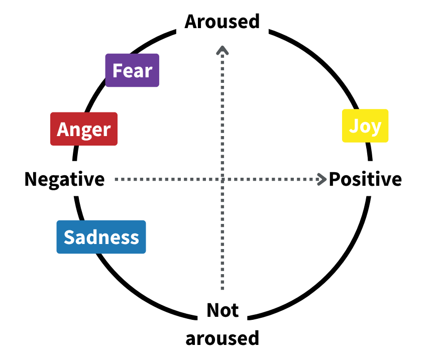{width="90%" fig-align="left"}

:::


::: {.column width="55%"}

::: {style="position: relative; min-height: 260px;"}

::: {.fragment data-fragment-index="1"}

- arousing emotions enable **biased information processing** by

    - making us better select, process and memorize vital information

    - hindering systematic processing [@eckerPsychologicalDriversMisinformation2022]

:::

::: {style="position: relative; min-height: 120px;"}

::: {.fragment .fade-in-then-out data-fragment-index="2" style="position: absolute; top: 0; left: 0; width: 100%;"}

> anger $\rightarrow$ emotional confirmation

:::

::: {.fragment data-fragment-index="3" style="position: absolute; top: 0; left: 0; width: 100%;"}

> fear $\rightarrow$ openness effect

:::

:::


:::

:::

:::


::: notes

- while we think that emotions are universal reactions, they are predictions by our brains based on bodily sensations called core affect, which indicates how aroused and how negative or positive we feel

- the circumplex model by Russel allows us to categorize some common emotions, here with anger and fear being arousing and negative and joy being arousing and positive

- and so in the context of information processing, emotions with high arousal have a reinforcing effect on biased information processing as they make us better select, process and memorize vital information through a process called motivated reasoning, but they also hinder systematic evaluation of the veracity of content

- for example, when experiencing anger, we may narrow our attention and faster process information that confirms our beliefs

- or when feeling fear, we may seek for other information, making us more open to new sources


:::


## Emotions and misinformation


::: columns


::: {.column width="55%"}


::: {style="position: relative; min-height: 120px;"}

::: {.fragment .fade-out data-fragment-index="2" style="position: absolute; top: 0; left: 0; width: 100%;"}

- arousing emotions are linked to misinformation acceptance [ @martelRelianceEmotionPromotes2020; @greensteinAngerIncreasesSusceptibility2020]

::: {.fragment data-fragment-index="1"}


- misinformation is more emotional and has **secondary effects**, e.g., loss of trust [@ognyanovaMisinformationActionFake2020]

:::

:::

::: {.fragment data-fragment-index="2" style="position: absolute; top: 0; left: 0; width: 100%;"}

**I. Direction of effects**

**_RQ1:_** How do emotions influence the processing and spread of misinformation, and to what extent does misinformation in turn affect emotional responses?

:::

:::

::: {.fragment data-fragment-index="3"}

<br>
<br>
<br>


:::

::: {style="position: relative; min-height: 120px;"}

::: {.fragment .fade-in-then-out data-fragment-index="3" style="position: absolute; top: 0; left: 0; width: 100%;"}

- if misinformation feeds back into emotions, emotions are more persistent -- rather than situational states [@szymaniakTraitAngerApproach2023; @harmon-jonesBeliefConspiracyTheories2024]

:::

::: {.fragment data-fragment-index="4" style="position: absolute; top: 0; left: 0; width: 100%;"}

**II. Temporal scale**

**_RQ2:_** To what extent does the relationship between emotions and misinformation vary across different temporal scales, from momentary states to long-term traits?

:::

:::

:::

::: {.column width="45%"}


{width="35%" fig-align="center"}

::: {.fragment data-fragment-index="1"}
{width="35%" fig-align="center"}
:::

<br>

::: {.fragment data-fragment-index="3"}
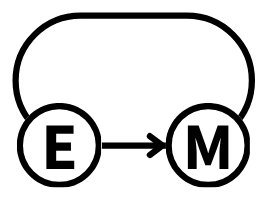{width="35%" fig-align="center"}
:::


:::

:::

::: notes

- in the context of misinformation specifically, such arousing negative emotions have shown to predict misinformation acceptance

[CLICK]

- at the same time, misinformation tends to be more negative and moralizing, having secondary effects beyond belief, for example, antagonizing groups with different beliefs or losing trust in democratic institutions

[CLICK]

- therefore, because we have focused both on prior emotions and only as beliefs as outcome, I raise the question of the direction of effects, whether emotions predict misinformation acceptance and whether misinformation, in turn, affects emotions


[CLICK]

- now, if misinformation indeed feeds back into emotions, then these emotions might be more persistent and long-term

[CLICK]

- therefore, my second research question asks at what temporal scale exactly the relationship plays out

- do momentary emotional states predict misinformation acceptance and sharing or long-term emotional traits?

:::


## Emotions and misinformation


::: columns

::: {.column width="55%"}

::: {style="position: relative; min-height: 220px;"}

::: {.fragment .fade-out data-fragment-index="2" style="position: absolute; top: 0; left: 0; width: 100%;"}

- emotions are deeply **social and communicative** through

    - signaling a social position [@hareliSocialSignalValue2012] and connecting with like-minded [@papacharissiAffectivePublicsStructures2016]

    - expressing synchronized emotions during crises [@garciaCollectiveEmotionsSocial2019; @metzlerCollectiveEmotionsCOVID192023]
    
<br>

::: {.fragment data-fragment-index="1"}

- individual-level effects can **generate or hide macro-level patterns**, or vice versa [@frischlichComplexityMisinformationExtends2025]

:::

:::


::: {.fragment data-fragment-index="2" style="position: absolute; top: 0; left: 0; width: 100%;"}

**III. Levels**


**_RQ3:_** How does the relationship between emotions and misinformation differ across individual, group, and collective levels of analysis?


:::

:::

:::

::: {.column width="45%"}

<br>

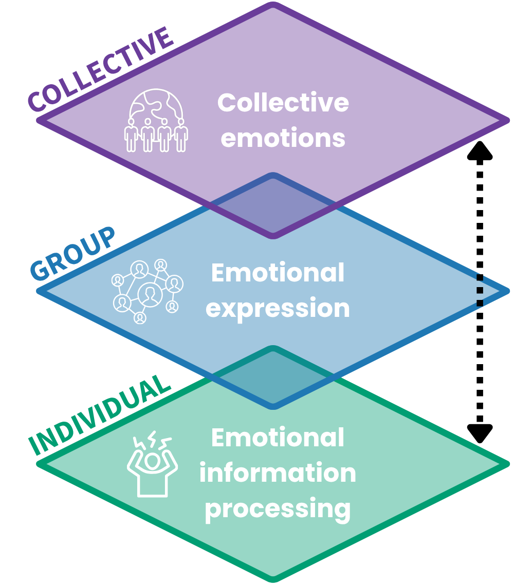{width="80%" fig-align="right"}

:::

:::


::: notes
- beyond this inward function, emotions are also expressive and have social and communicative functions, especially on social media

- people express their emotions to signal their social positions, like to connect with the social group they love and disconnect with the group they hate

- or to share their feelings about a crisis, turning into a collective emotion

- therefore, I argue that emotions have different functions which play out at different levels

[CLICK]

- and that individual-level effects may scale into second-order patterns, for example, groups hating each other, or likewise, macro patterns hide it

[CLICK]

- so to understand this, it is important to understand how the relationship between emotions and misinformation differs across levels

:::


## Methodological considerations


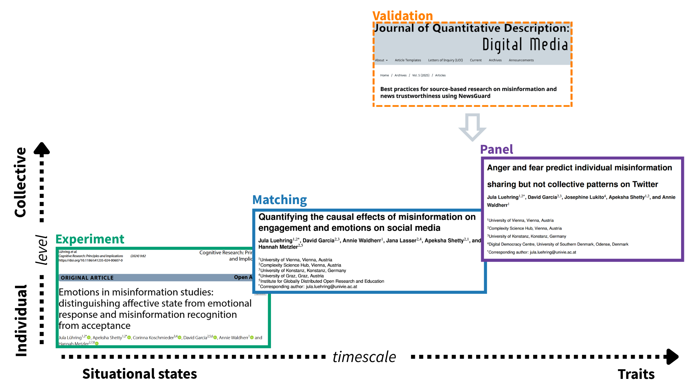{width="90%" fig-align="center"}


::: notes

- I contributed to these questions with a multifaceted, explorative design that understands emotional and social dynamics as components of a complex information processing system, including cognitive, affective, social, and technological factors 

- four first-authored papers, cover a within-person survey experiment with internal validity, a quasi-experimental matching on social media data, offering external/ecological validity, a longitudinal social media panel, focusing on temporal and multilevel dynamics

- all papers share German-language countries as a shared context

- in the following, I will briefly highlight the major results, leaving out the validation study

:::


# RQ1: Direction of effects {background-image="figures/causal_combined.png" background-size="15%" background-position="85% 85%"}


::: notes

- To get answers to the question of the direction of effects,...

[CLICK]

::: 


## [experiment]{.tag-experiment}: emotional state vs. response {background-image="figures/causal_em.png" background-size="7%" background-position="95% 5%"}

::: columns

<br>

::: {.column width="40%"}
Pre-registered **within-user experiment** and replication of @martelRelianceEmotionPromotes2020

-   N=422 Austrian sample

-   24 false/accurate COVID-19 news items

<br>


:::

::: {.column width="60%"}

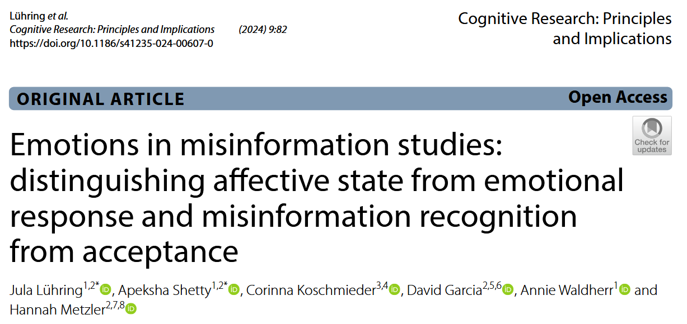{width="90%" .border-experiment}

:::


<br>

::: {.fragment .tag-experiment}

$\rightarrow$ arousing emotional states **did not predict** misinformation acceptance

:::

:::


::: footer

Luehring<sup>†</sup>, Shetty<sup>†</sup> et al. [-@luhringEmotionsMisinformationStudies2024]<br>
<sup>†</sup>shared first authorship

:::

::: notes

- we conducted a pre-registered within-person experiment, replicating colleagues by testing how good or bad 422 Austrian participants were at discerning false from true news items

- we could not find that an emotional state before exposure to the news items predicted acceptance of false news
:::


## [experiment]{.tag-experiment}: emotional state vs. response {background-image="figures/causal_me.png" background-size="7%" background-position="95% 5%"}


<br>


- **but** more anger and less joy *in responses* to false news

::: fragment

::: columns

::: {.column width="80%"}

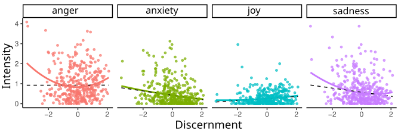{fig-align="left"}

:::

::: {.column width="20%"}

<br>
🗯 *"Fake", "Bullshit", "Nonsense"*

:::

:::
:::

::: {.fragment .tag-experiment}

$\rightarrow$ response > prior state

$\rightarrow$ prior beliefs determine emotional response


:::


::: footer


Luehring<sup>†</sup>, Shetty<sup>†</sup> et al. [-@luhringEmotionsMisinformationStudies2024]

:::


::: notes

- but we found more anger and less joy in the emotional response

- and when we asked participants for their first thoughts on the news, they often said "bullshit", indicating misbelief

- this was confirmed by the figure here, showing people who were especially bad and good got angrier -- the U-shape on the left

- so, the emotional response has shown to be more indicative of the emotional involvement in misinformation processing

- and the prior beliefs determined the felt emotion

:::

## [experiment]{.tag-experiment}: limitations

<br>

::: columns

::: {.column width="60%"}

- unrepresentative samples with little misperceptions

- artificial stimuli

- fail to capture group- or platform-level interactions [@bak-colemanMovingInformativeActionable2025]


::: fragment

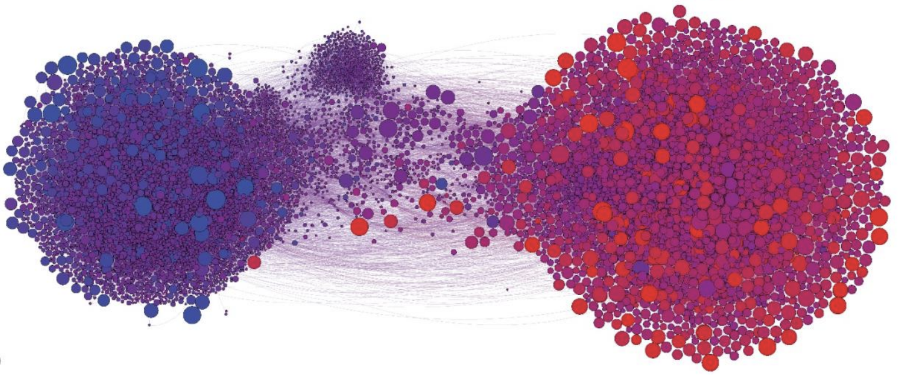{width="80%"}

:::

:::

::: {.column width="40%"}

{width="80%" fig-align="left"}

:::

:::


::: notes

- now, experiments can give us insights into the individual-level mechanisms but, as we could see in our experiment here, 

- they often rely on science-friendly samples with little belief in misinformation

- use made-up stimuli that do not look like the news that people consume in real life -- like here on the right,

- and they fail to capture the complex dynamics on social media 

[CLICK]

- when we know that misinformation spreads in these networked communities

::: 


## Studying misinformation in the real world


<br>

::: columns

::: {.column width="47%"}

### 1.) **Social media data**

- users reacting to misinformation in the real world 

- the complex interactions in a naturalistic setting

<br>


::: {style="position: relative; min-height: 220px;"}

::: {.fragment .fade-in-then-out data-fragment-index="1" style="position: absolute; top: 0; left: 0; width: 100%;"}

### 2.) Misinformation as claims

  -   misrepresents the broader spectrum of news

  -   reflects distinct properties of extreme types

:::

::: {.fragment .fade-in data-fragment-index="2" style="position: absolute; top: 0; left: 0; width: 100%;"}

### 2.) Misinformation as coming from unreliable sources

- includes decontextualized content

- generalizes across topics and contexts

- is scalable and reliable

:::

:::

        
:::

::: {.column width="5%"}

:::

::: {.column width="48%"}

::: fragment 

...but this approach **conceptually blurry**

$\rightarrow$ no intent but lack of editorial standards?
  
{width="60%"}  
        
:::


::: {.fragment .tag-validation}

$\rightarrow$ generalizability > construct validity<sup>1</sup>


:::
        
:::


:::

::: notes

- so how can we study misinformation in the wild? 

- in the following studies, we used social media with real users reacting to misinformation in the real world covering their complex interactions in a naturalistic setting

[CLICK]

- then, to detect misinformation in our datasets, we can rely on identifying false claims that were factchecked and compare them to more neutral claims

- however, this misrepresents the broader spectrum of news and may reflect distinct topics or sensationalist reporting of these extreme types

[CLICK]

- so instead, we measure misinformation as news coming from unreliable sources, which includes more subtle content, generalizes across topics and is scalable and reliable

[CLICK]

- unfortunately, this operationalization is conceptually blurry as it assumes that all news from an unreliable source is equally false and it assumes that all sources do not have the intent to harm 

- circling back to our definition, we can argue that online news media often lack editorial norms and frequently select and interpret factual events based on ideological preferences but they are rarely part of organized disinformation campaigns that aim at harming


:::

::: footer

<sup>1</sup>see in [validation]{.tag-validation}: @luhringBestPracticesSourcebased2025 

:::


## [matching]{.tag-matching}: effects on social media {background-image="figures/causal_me.png" background-size="7%" background-position="95% 5%"}

::: columns

::: {.column width="70%"}

<br>

**Causal matching analysis** of 9.9M German news tweets and 1M discussions (Oct 2020-Mar 2022)
:::

::: {.column width="30%"}

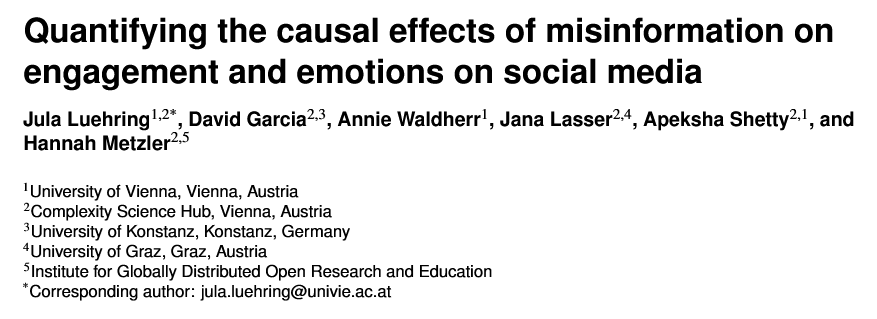{width="90%" .border-matching}

:::


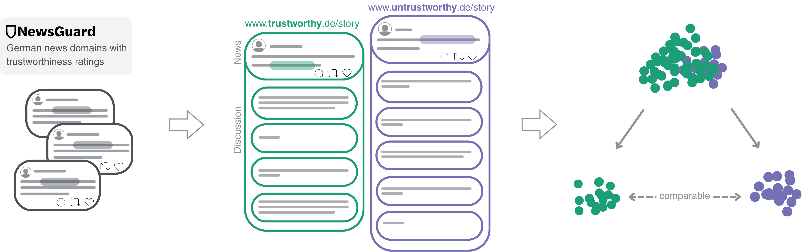{width="70%" fig-align="left"}

:::


::: footer

@luhringQuantifyingCausalEffects2025

:::


::: notes

- we applied these methods in practice in this paper, where we analyzed the effects of misinformation on engagement and emotions in discussions on Twitter

- so here, we used a list of German news sources with trustworthiness scores to find tweets mentioning them, and the discussion threads below

- then, instead of randomizing as we would do in an experiment, we create synthetic control and treatment groups, with untrustworthy news being the treatment, and we make them statistically equivalent

:::

## [matching]{.tag-matching}: effects on emotions in discussions {background-image="figures/causal_me.png" background-size="6%" background-position="97% 3%"}

<br>

<br>

::: columns

::: {.column width = "80%"}

{width="800" fig-align="left"}

:::

::: {.column width = "20%"}

<br>

::: {.tag-matching}

$\uparrow$ **more** anger, disgust and fear 

$\downarrow$ and **less** joy 

:::
      
:::

:::


::: footer

@luhringQuantifyingCausalEffects2025

:::


::: notes

- now, similarly to the within-person experiment, we can see here in this figure that untrustworthy news, compared to trustworthy news, get more negative responses, namely more anger, fear and disgust, but also less joy 

:::


# Misinformation has effects on negative emotions, but the same emotions do not *necessarily* predict acceptance. {background-image="figures/causal_combined.png" background-size="15%" background-position="90% 90%"}


# RQ2: In the moment or over longer time periods? {background-image="figures/causal_feedback.png" background-size="15%" background-position="90% 90%"}

::: notes

- we've looked into short-term emotions, but now we are interested in long-term emotions

::: 

## [panel]{.tag-panel}: momentary vs. long-term emotions {background-image="figures/causal_feedback.png" background-size="7%" background-position="95% 5%"}

<br>

::: columns

::: {.column width="60%"}

<br>

Pre-registered **longitudinal analysis** of a panel of 29k Austrian ordinary Twitter users (135M tweets; 2019-2023) sampled by location, not by news sharing


::: fragment

<br>

- prior emotional states **did not predict** untrustworthy news sharing (in line with [experiment]{.tag-experiment})

:::

:::


:::{.column width="40%"}


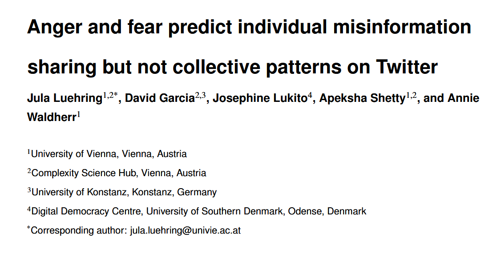{width="90%" fig-align="right" .border-panel}

:::

:::

::: notes

- in this study, we also relied on social media data, but instead of sampling based on news, we sample a relatively random set of users based on their location in Austria and we extracted everything they posted between 2019 and 2023, generating a social media panel dataset

- and again, we find that whether they expressed an emotion did not predict them sharing untrustworthy news, which is line with the experiment

:::


## [panel]{.tag-panel}: momentary vs. long-term emotions {background-image="figures/causal_feedback.png" background-size="7%" background-position="95% 5%"}

<br>

::: columns

::: {.column width="45%"}

- **average** $\rightarrow$ stable baseline over long time

- **dynamics** $\rightarrow$ fluctuations and erratic changes 


<br>

::: {.fragment .tag-panel}

$\rightarrow$ higher levels of and erratic emotional expressions predict sharing untrustworthy news


:::

:::


:::{.column width="5%"}

:::

:::{.column width="50%"}


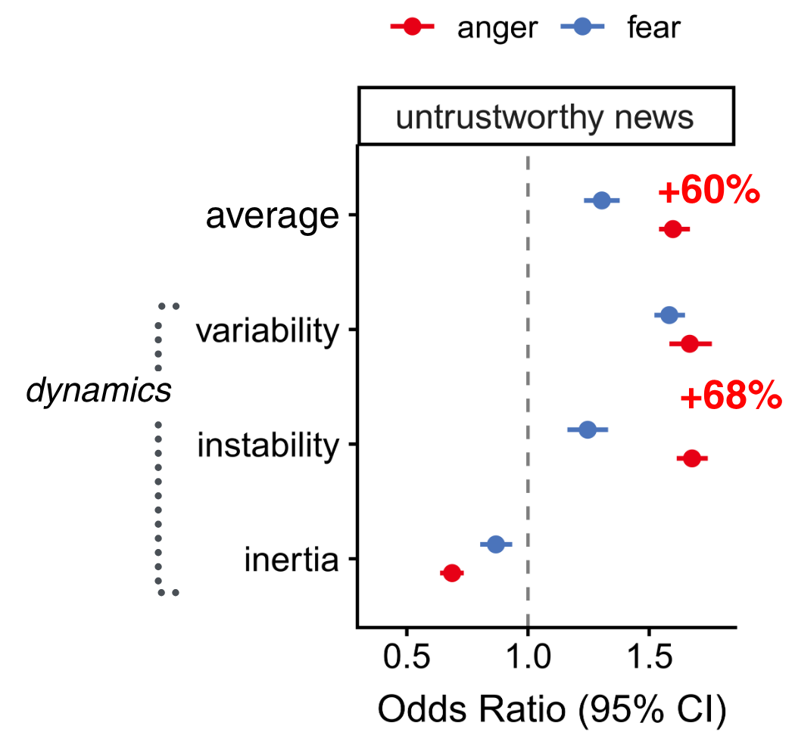{fig-align="center" width="80%"}

:::

:::

::: footer

@luehringAngerFearPredict2026

:::


::: notes

- when we aggregate their anger and fear levels over a longer time period, higher levels increase their chance of spreading untrustworthy news by roughly 60%

- but not only higher levels, also strong fluctuations, hinting at bad emotion regulation capacities predict it

:::


# Long-term emotions rather than momentary states predict engagement with misinformation. {background-image="figures/causal_feedback.png" background-size="20%" background-position="90% 90%"}


# RQ3: At the individual or more collective levels? {background-image="figures/thesis_model.png" background-size="20%" background-position="95% 90%"}

::: notes

- Lastly, when we look at different levels

:::

## [panel]{.tag-panel}: collective emotions and sharing {background-image="figures/thesis_model.png" background-size="7%" background-position="90% 5%"}


<br>

{width="60%" fig-align="center"}

<br>

::: {.fragment .tag-panel}

$\rightarrow$ mostly **event-driven:** higher emotions do not predict untrustworthy news sharing and vice versa

:::


::: footer

@luehringAngerFearPredict2026

:::

::: notes

- in the panel study, we analyzed to what extent emotions expressed by many people at the same predict misinformation spreading, for example, in times of a crisis

- we could not find that this is the case

- instead, as you can see here in the top panel, both spike with domestic and global crises

- and the share of untrustworthy news, here in purple, remains overall very low

:::

## [panel]{.tag-panel}: the motivated minority {background-image="figures/thesis_model.png" background-size="7%" background-position="90% 5%"}

::: columns

::: {.column width="50%"}

<br> 

<br>

| Sharing | Users | Proportion |
|---|---:|---:|
| Any news | 24,367 | 83.5% |
| Partisan news | 10,589 | 36.3% |
| Untrustworthy news | 4,104 | [14.1%]{.tag-panel} |


:::

::: {.column width="50%"}

<br>

::: r-stack

::: {.fragment .fade-out fragment-index=1}
{fig-align="center" width="60%"}
:::

::: {.fragment .fade-in fragment-index=1}
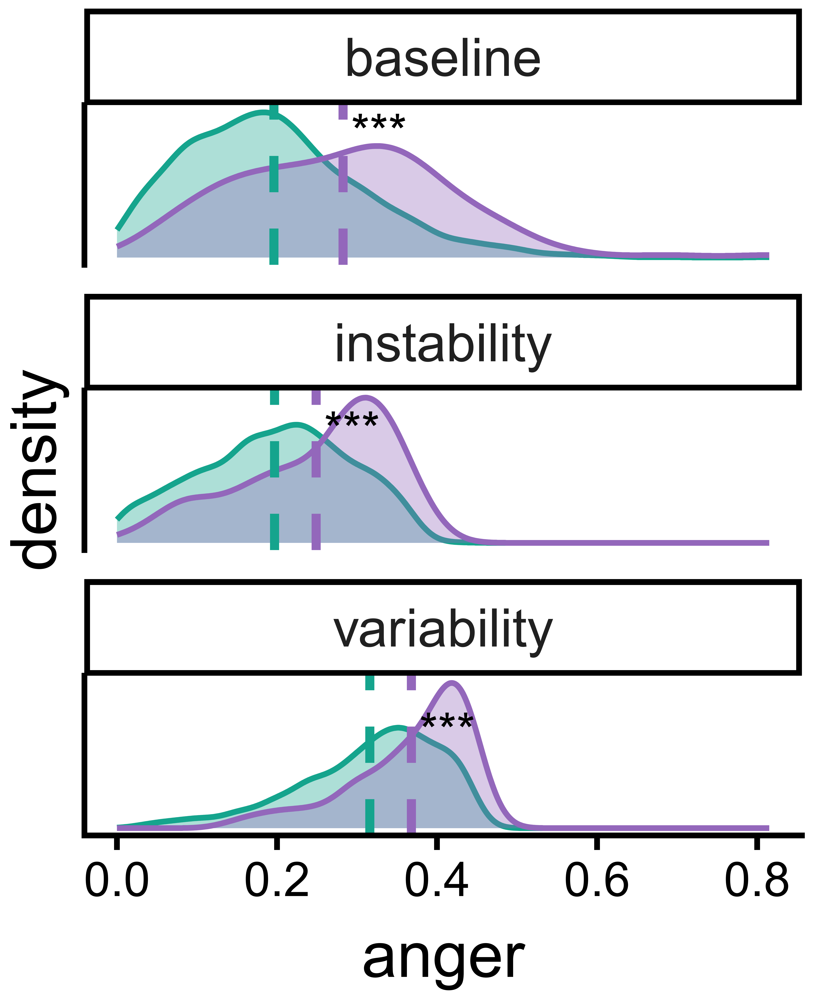{fig-align="center" width="50%"}
:::

:::

:::

:::


::: {.fragment .tag-panel}

$\rightarrow$ the majority of untrustworthy news is shared by supersharers with distinct emotional profiles

:::

::: footer

@luehringAngerFearPredict2026

:::


::: notes

- zooming in on the users again, only 14% have ever shared untrustworthy news

- and 80% of it is shared by only 0.5% of users, with higher anger levels as well as again, worse emotion regulation capacities

[CLICK]

- so the majority of untrustworthy news is shared by supersharers with distinct dysfunctional emotional profiles

:::

# The relationship is observable in individuals and groups but disappears with aggregation. {background-image="figures/thesis_model.png" background-size="15%" background-position="95% 95%"}


## [matching]{.tag-matching} & [panel]{.tag-panel}: limitations and future

<br>


- Emotion measurement **fails to understand the reason or target** of an emotion

  $\rightarrow$ directed sentiment, qualitative methods and linkage studies

<br>

- **Generalizability** bounded by platform, country, and time

  $\rightarrow$ cross-platform studies and effects beyond social media


::: notes

- of course, relying on social media data also has some additional limitations

- first, we used machine learning classifiers to measure emotional expressions, which fails to understand the reason or target of an emotion

- second, it limits the generalizability of our findings
:::

# Contributions {.center background-image="figures/thesis_flowchart.png" background-opacity="0.25" background-size="70%"}

::: notes

- Nonetheless, I would like to highlight both the substantive and methodological contributions of this dissertation

::: 

## Methodological contributions

<br>


- **Triangulated design** responding to the overreliance on artificial lab stimuli and unrepresentative samples

<br>

- Systematic **empirical audit** of NewsGuard and discussion of source-based measurement methods, filling a measurement gap

<br>

- **Conceptual distinction** of prior emotional state vs. immediate emotional responses

::: notes


:::

## Reconciling "overstated" vs. "serious threat"

<br>

::: columns


::: {.column width="55%"}

- Emotions do not, per se, make people more susceptible to misinformation

- Misinformation plays into dysfunctional emotional mechanisms

- On social media, **supersharers with distinct emotional traits** primarily share and engage with untrustworthy sources

:::

::: {.column width="10%"}

:::

::: {.column width="30%"}

{width="75%" fig-align="left"}

:::


:::

::: fragment

$\rightarrow$ the relationship is **scale-dependent**: aggregate patterns **mask** individual level (=*ecological fallacy*)

$\rightarrow$ effects are **heterogeneous**: not in line with spread of misinformation as contagion

$\rightarrow$ the problem is not overstated, **but needs a rethinking**

:::


::: notes

- To sum up the substantive contribution, I found that ...

- Rather, ...

- This shows that the relationship is heterogeneous and scale-dependent, meaning it is strong at individual and group levels, but less visible at the aggregate level

:::

## Normative implications

<br>

- normative reframing of the "motivated minority" as a diagnostic of **deeper structural conditions**

- **attention economy** on digital platforms reinforces the spread of hateful and potentially untrue content

<br>


::: {.fragment .tag-matching}

$\rightarrow$ media literacy training needs to focus on emotion regulation, not just skepticism

$\rightarrow$ journalists (and political communication more broadly, really) need to acknowledge emotions and the causes while not playing into them

$\rightarrow$ platforms need to be held accountable and de-prioritize moralizing content

:::

::: notes
- this rethinking has normative implications for the understanding of the motivated minority not as an angry mob but as a deeper structural conditions, not as a target for inoculation/nudging

- and the attention economy on social media platforms reinforcing the spread of hateful and potentially untrue content

- in practice, this means that instead of blaming individuals and banning young people from social media, we need to focus more on teaching them media literacy including emotion regulation tactics, as well as making an effort to understanding and acknowledging the root causes instead of angry audiences fragmenting

- lastly, platforms need to be held accountable...

:::

# Closing {.center}

::: notes

- concluding, for us researchers, this rethinking means shifting from debating how prevalent misinformation is to trying to better understand the root causes of misinformation, and how it may affect us and whole populations through secondary effects beyond belief.

:::

## It takes a village{visibility="uncounted"}

{.r-stretch}

## It takes a village{visibility="uncounted"}

{.r-stretch}

## Appendix: Exposure vs. engagement {visibility="uncounted"}

<br>

| Study | What it measured | What it did **not** measure |
|---|---|---|
| [experiment]{.tag-experiment} | Discernment of 24 COVID news items | No exposure choice |
| [matching]{.tag-matching} | Sharing/replying to tweets | Exposure choice |
| [panel]{.tag-panel} | Sharing of news links | Exposure choice |

<br>

::: fragment

$\rightarrow$ supports **selection into engagement/sharing**

$\rightarrow$ not **selective exposure** in the classic sense (choosing what to see) as none of the four studies measured this 

:::

## Appendix: Welcome to the world of emotion theories {visibility="uncounted"}

::: columns

::: {.column width="55%"}

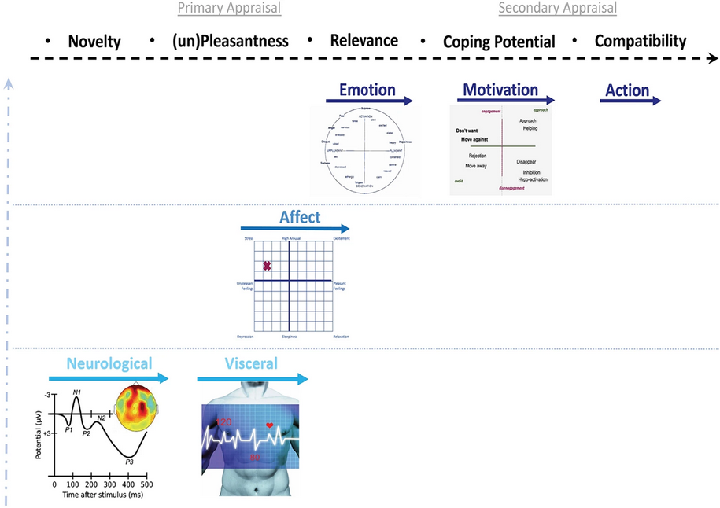{fig-align="center" width="95%"}

:::

::: {.column width="45%"}

**affect vs. mood vs. emotion**

- **affect**: core, non-object-directed (valence + arousal)
- **mood**: diffuse, no object, longer-lasting
- **emotion**: object-directed & contextual: appraisal + feeling + expression + action tendency

<br>

**action tendencies**

- anger $\rightarrow$ approach / confront
- fear $\rightarrow$ avoid
- disgust $\rightarrow$ reject / adapt

:::

:::


## Appendix: Claim vs. source-level sampling {visibility="uncounted"}


<br>

::: columns


::: {.column width="50%"}

- **Bias**: Even if we overgeneralize across articles and error rate for article accuracy is high, source judgments can still be unbiased at the macroscale

- **Precision**: Agreement across different lists for US context [@linHighLevelCorrespondence2023] and expert vs. crowdsourced ratings are similar [@pennycookFightingMisinformationSocial2019]

:::

::: {.column width="5%"}

:::


::: {.column width="45%"}

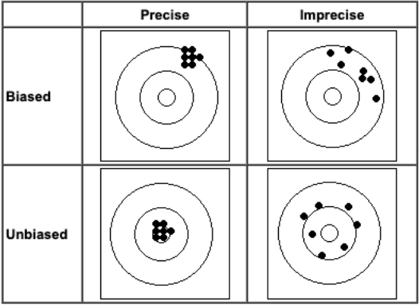{width="80%" fig-align="center"}

- Journalistic norms depend on media system

- Excludes misinformation spread by regular users

:::

:::


## Appendix: Onion graph of fake news measures {visibility="uncounted"}

![**Figure A.3.** Tweet by Deb Roy, author of @vosoughiSpreadTrueFalse2018 at: (https://x.com/dkroy/status/974251282071474177)[https://x.com/dkroy/status/974251282071474177].](figures/roy_tweet.png){width="55%"}


## Appendix: NewsGuard [validation]{.tag-validation} {visibility="uncounted"}

::: columns

::: {.column width="30%"}

<br>

* majority of sources are US-based (~76%)

* trustworthiness scores vary by country (US lowest on avg.)

* stability = 1/2 SD, completeness = growth less than 5%

* stable state reached by ~2022 for US, DE, FR, IT, CA

:::


::: {.column width="70%"}

{width="90%"}

:::

:::

::: footer

@luhringBestPracticesSourcebased2025
:::


## [matching]{.tag-matching}: unobserved confounders {visibility="uncounted"}


```{dot}
//| fig-width: 6
//| fig-height: 4.2
digraph DAG {
  graph [rankdir=LR, bgcolor="transparent", nodesep=0.2, ranksep=0.35, fontname="Source Code Pro"];
  node  [fontname="Source Code Pro", fontsize=15, shape=box, margin="0.35,0.12", height=0.8, style="rounded,filled", color="#003C78", penwidth=1.2];
  edge  [color="#555555", arrowsize=0.8, penwidth=1.3];

  // matched confounders (poster side)
  bias   [label="Political bias", fillcolor="#DCEBF7"];
  author [label="Author (followers,\n following, tweets)", fillcolor="#DCEBF7"];
  post   [label="Post (topic,word\ncount, emotions)", fillcolor="#DCEBF7"];

  // unobserved
  topic  [label="Unobserved", style="rounded,dashed", color="#888888", fontcolor="#666666"];

  // treatment, mediator, outcome
  T [label="Untrustworthy news", fillcolor="#8A2BE2", fontcolor="white", color="#8A2BE2"];
  M [label="Self-selection,\ncuration", fillcolor="white", color="#1E8CC8"];
  Y [label="Engagement &\nreply emotions", fillcolor="#1E8CC8", fontcolor="white", color="#1E8CC8"];

  {rank=same; bias; author; post; topic}

  bias -> T;   bias -> Y;
  author -> T; author -> Y;
  post -> T;   post -> Y;
  topic -> T [style=dashed, color="#888888"];
  topic -> Y [style=dashed, color="#888888"];

  T -> M -> Y [penwidth=2.2, color="#8A2BE2"];
}
```

[**Figure A.5.** Directed Acylic Graph (DAG) with <span style="background:#DCEBF7;padding:0 4px">matched</span>; *dashed* = unobserved; <span style="color:#1E8CC8">**who replies**</span> = part of the effect, not matched.]{style="font-size:60%"}


## Appendix: Practical implications on emotion regulation {visibility="uncounted"}

::: columns

::: {.column width="50%"}

**Emotion regulation**

- **instability/volatility (MSSD)**, not just baseline anger, predict sharing

$\rightarrow$ regulation-focused media literacy, not only source-skepticism

:::

::: {.column width="50%"}

**Angry audiences**

- disgust and fear are robust **within-user effects** of untrustworthy content, whereas anger is also trait-based

$\rightarrow$ acknowledge: audiences are responding to something, not just being irrational

:::

:::


::: fragment

$\rightarrow$ *positive liberty* [-@berlinTwoConceptsLiberty1958]: the "motivated minority" may lack the capacity for meaningful participation, not just the will
$\rightarrow$ populations with **public broadcasting** are more resilient to disinformation [@humprechtResilienceOnlineDisinformation2020]

:::

::: footer

:::

## Appendix: Study 1 {visibility="uncounted"}

<br>

- Misperception scale: **9 COVID-19 statements**, agreement rated **0--100%**, sample M = **21.56%**

| Study 1 design | Detail |
|---|---|
| Design | Within-person **experiment** (manipulated exposure: 12 false / 12 real items) + survey self-report |
| Own RQs | prior state $\rightarrow$ discernment? exposure $\rightarrow$ emotional reaction? reaction differs: recognizers vs. acceptors? |
| $\rightarrow$ RQ1 (directionality) | tests **both** directions |
| $\rightarrow$ RQ2 (temporality) | shortest timescale (momentary, single session) |
| $\rightarrow$ RQ3 (levels) | individual level only |


## Appendix: Integrated model {visibility="uncounted"}

::: columns

::: {.column width="45%"}

{width="85%" fig-align="left"}

:::

::: {.column width="55%"}

- **constructionist** view: emotions = predictions built from core affect $\rightarrow$ individual level
- emotions are **social/communicative** [@hareliSocialSignalValue2012] $\rightarrow$ group level: expression, identity signaling
- collective/affective publics, synchronized crisis response $\rightarrow$ collective level

$\rightarrow$ misinformation as an **epistemic disorder** spreads across all three levels

$\rightarrow$ differential **aggregation**: visible patterns at individual/meso level, statistically invisible at macro level [*ecological fallacy*, @frischlichComplexityMisinformationExtends2025]

:::

:::


## Appendix [matching]{.tag-matching}: effects on engagement {visibility = "uncounted" background-image="figures/thesis_model.png" background-size="7%" background-position="90% 5%"}

::: {.columns style="display: flex; align-items: center;"}

::: {.column width="70%"}

- only **6% of news tweets** link to untrustworthy news sources

::: {.fragment fragment-index=1}

- yet they get **33% more retweets and 12% more quote retweets**

:::

:::

::: {.column width="30%"}

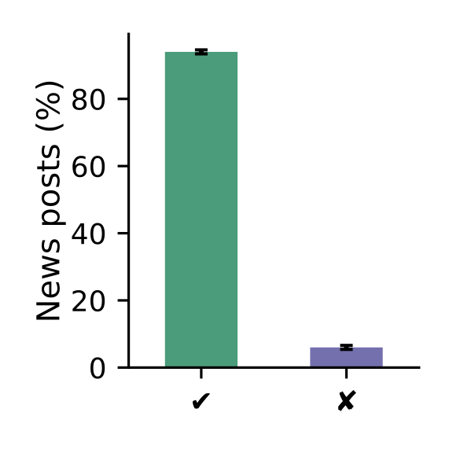{width="55%"}

:::

:::

::: {.fragment fragment-index=1}

::: {.columns style="display: flex; align-items: center;"}

::: {.column width="80%"}
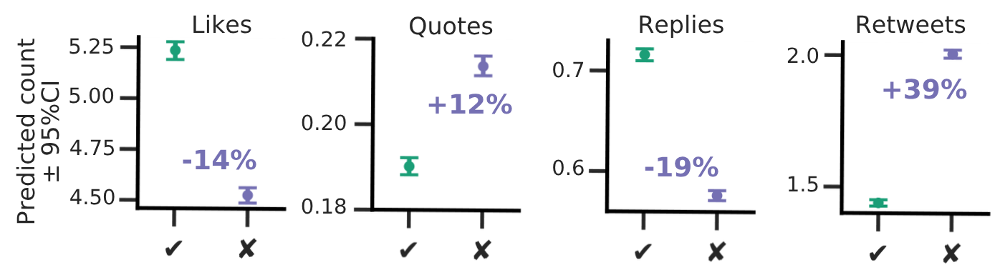{width="100%"}
:::

::: {.column width="20%"}

::: {.tag-matching}

$\uparrow$ spreads through **reshares**

$\downarrow$ not through likes & replies
:::

:::

:::

:::


::: footer

@luhringQuantifyingCausalEffects2025

:::

::: notes

- in line with this, the matching paper also found that only 6% of news pointed to untrustworthy sources

- and that untrustworthy news shows distinct patterns in how it spreads

- it spreads through reshares rather than likes and replies, highlighting this connective, community-based spread

:::


## References


